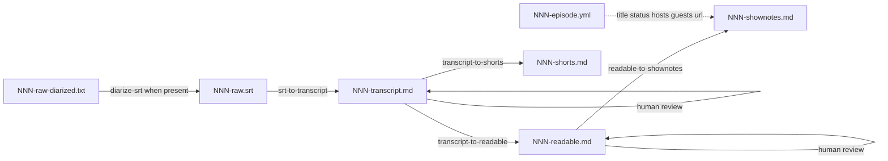

# Basic Block Radio

Knowledge base for the Basic Block Radio podcast — deep technical interviews about blockchain technologies in Russian.

- Content model and folder layout: `docs/content-model.md`
- Public website product brief: `docs/website.md`
- Tasks: `_tasks/tasks.md`

## Repository structure

```
├── README.md
├── podcast-info.md
├── PROJECT_STATUS.md
├── pipeline-launch.md
├── _tasks/
│   └── tasks.md
├── docs/
│   ├── content-model.md            # Data model and layout (source of truth)
│   └── website.md                  # Public archive product brief
├── content/
│   ├── episodes/
│   │   ├── templates/
│   │   │   ├── episode-template.yml
│   │   │   ├── transcript-template.md
│   │   │   └── shownotes-template.md
│   │   └── NNN/
│   │       ├── NNN-episode.yml     # Canonical episode metadata
│   │       ├── NNN-raw.srt         # Canonical raw (Format A or B)
│   │       ├── NNN-raw-diarized.txt  # Optional speaker-track export
│   │       ├── NNN-raw-undiaried.srt # Format A kept after diarize-srt
│   │       ├── NNN-transcript.md
│   │       ├── NNN-readable.md
│   │       ├── NNN-shownotes.md    # Full public article
│   │       ├── NNN-shorts.md
│   │       └── .chunks/
│   ├── people/
│   ├── organizations/
│   └── sponsorships/
├── site/                           # Website project (not implemented yet)
├── scripts/
└── .agents/
    ├── skills/
    ├── dictionary.md
    └── editing-standards.md
```

## Workflow overview

Two deliverable tracks share the same transcript. Long-form publication uses readable + show notes. Short-form clips use the transcript only (verbatim excerpts with montage elisions).



Run one agent skill per step unless the user asks to combine steps. Each skill file under `.agents/skills/` defines scope, inputs, and stop conditions.

## Step by step

### 1. Subtitles

Generate `content/episodes/NNN/NNN-raw.srt` with Whisper on the episode audio.

- Model `medium` is a practical CPU choice for Russian.
- VAD filter with max segment duration around 20s improves stability.

### 1a. Diarize (when a speaker-track TXT exists)

If the export includes `NNN-raw-diarized.txt` (labels + coarse times) alongside undiarized `NNN-raw.srt`, run `diarize-srt` before the transcript pass.

- Merges SRT wording/times with TXT speakers into Format B.
- Promotes Format B into `NNN-raw.srt`; keeps Format A as `NNN-raw-undiaried.srt`.
- Helper script lives under the skill directory (not `scripts/` at repo root).

Skill: `.agents/skills/diarize-srt/SKILL.md`

Skip this step when there is no diarized TXT (Format A `NNN-raw.srt` goes straight to the transcript skill).

### 2. Transcript (pass 1)

Run the `srt-to-transcript` skill on `NNN-raw.srt`.

- Timestamped paragraphs, speaker labels, dictionary spellings, light filler cleanup.
- Does not rewrite for readable prose.
- Format A or Format B auto-detected from file content.
- After `diarize-srt`, provide `speaker_map` from export labels to Cyrillic full names.
- Output `content/episodes/NNN/NNN-transcript.md` (frontmatter: `episode` only).
- Create or update `NNN-episode.yml` for identity (hosts/guests slugs, dates, title when known).
- Sponsor lines in the recording can be aligned with `content/sponsorships/` when building the transcript.

Skill: `.agents/skills/srt-to-transcript/SKILL.md`

### 3. Transcript review

Human review of `NNN-transcript.md`.

- Speakers, boundaries, technical terms (`.agents/dictionary.md`).
- Missed turns can be added as new lines with `()` for the time and initials for the speaker (`ST`, `MG`, `II`).
  Run `expand-transcript-placeholders` to expand those initials to in-file full names, fill empty timestamps, and spread copied start times.
- When satisfied, set `status: transcript-reviewed` on `NNN-episode.yml`.
- Then run downstream skills on this file.

Skill: `.agents/skills/expand-transcript-placeholders/SKILL.md`

### 4. Readable (pass 2)

Run `transcript-to-readable` on a `transcript-reviewed` `NNN-transcript.md`.

- One output line per input line (same timestamps and speakers; no merge or split).
- Copy-edit inside each block only.
- Long episodes: `scripts/split_transcript_chunks.py`, polish each chunk, then `scripts/merge_readable_chunks.py`. Chunk dirs live under `content/episodes/NNN/.chunks/` (gitignored).
- Output `NNN-readable.md` with the same minimal frontmatter as the transcript (`episode` only).

Skill: `.agents/skills/transcript-to-readable/SKILL.md`

### 5. Readable review

Check meaning, years (`.agents/editing-standards.md`), and flow before show notes.
When satisfied, set `status: readable-reviewed` on `NNN-episode.yml`.

### 6. Show notes

Run `readable-to-shownotes` on `NNN-readable.md`.

- Output `NNN-shownotes.md` without YAML frontmatter (full article body).
- Title line must match `title` in `NNN-episode.yml`.
- Sponsors from `content/sponsorships/` active for this episode number; `Ссылки:` from a URL list the user provides.
- Human review of show notes, then set `status: ready` on the episode YAML.

Skill: `.agents/skills/readable-to-shownotes/SKILL.md`  
Template: `content/episodes/templates/shownotes-template.md`

### 7. Shorts (optional)

Run `transcript-to-shorts` on a `transcript-reviewed` `NNN-transcript.md` (parallel with readable once the transcript is reviewed).

- Output `NNN-shorts.md`. Clip text is verbatim from the transcript only, not from `NNN-readable.md`.
- Segment layout, montage rules, `Диапазон в выпуске`, and the pre-finish checklist are defined in the skill, not duplicated here.

Skill: `.agents/skills/transcript-to-shorts/SKILL.md`

## Agent skills

| Skill | Input | Output |
|-------|--------|--------|
| `diarize-srt` | Format A `NNN-raw.srt` + `NNN-raw-diarized.txt` | Format B `NNN-raw.srt` (+ `NNN-raw-undiaried.srt`) |
| `srt-to-transcript` | `NNN-raw.srt` | `NNN-transcript.md` (+ `NNN-episode.yml` identity) |
| `expand-transcript-placeholders` | `NNN-transcript.md` during review | same file (initials, empty `()`, duplicate times) |
| `transcript-to-readable` | `NNN-transcript.md` | `NNN-readable.md` |
| `readable-to-shownotes` | `NNN-readable.md` + URL list | `NNN-shownotes.md` |
| `transcript-to-shorts` | `NNN-transcript.md` | `NNN-shorts.md` |

Shared references: `.agents/dictionary.md`, `.agents/editing-standards.md`, `podcast-info.md`.

Scripts under `scripts/`:

- `check_content.py` — deterministic content-model checks (run from repo root).
- Transcript chunking / merge helpers for `transcript-to-readable` only.

`diarize-srt` and `expand-transcript-placeholders` use helpers under their skill directories.
Skills that process Russian episode text do not call repo-root `scripts/` unless the skill explicitly says so (`transcript-to-readable` chunked mode only).

## Episode artifacts

| File | Role |
|------|------|
| `NNN-episode.yml` | Canonical metadata (title, status, hosts/guests, url) |
| `NNN-raw.srt` | Canonical raw for `srt-to-transcript` (Whisper Format A, or Format B after `diarize-srt`) |
| `NNN-raw-diarized.txt` | Optional speaker-track export for `diarize-srt` |
| `NNN-raw-undiaried.srt` | Format A preserved when `diarize-srt` promotes Format B into `NNN-raw.srt` |
| `NNN-transcript.md` | Canonical spoken wording and timestamps |
| `NNN-readable.md` | Canonical long-form reading text |
| `NNN-shownotes.md` | Full public article for site / platforms |
| `NNN-shorts.md` | Editor map for Shorts, Reels, or clip cuts |

Use one reviewed `NNN-readable.md` per episode for publication. Extra drafts, if kept, are outside the pipeline.

## Frontmatter and metadata

- Identity lives in `NNN-episode.yml` (see `content/episodes/templates/episode-template.yml` and `docs/content-model.md`).
- Speech files use minimal frontmatter: `episode: NNN` only (`content/episodes/templates/transcript-template.md`).
- `NNN-shorts.md` adds `source: NNN-transcript.md`.
- `NNN-shownotes.md` has no YAML frontmatter; first line is the title string from `NNN-episode.yml`.

Review gates are human workflow steps.
`status` on `NNN-episode.yml` records them:
`draft` → `transcript-reviewed` → `readable-reviewed` → `ready`.
`catalog` publishes a historical episode from its show notes and page URL.
A catalog episode becomes `ready` after a transcript and a readable file are reviewed.
The public site build includes `ready` and `catalog`.
