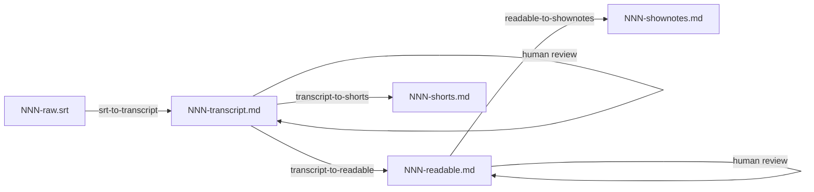

# Basic Block Radio

Knowledge base for the Basic Block Radio podcast — deep technical interviews about blockchain technologies in Russian.

Public website product decisions live in `docs/website.md`.
Parked one-line ideas live in `docs/IDEAS.md`.

## Repository structure

```
├── README.md
├── podcast-info.md
├── PROJECT_STATUS.md
├── pipeline-launch.md              # Batch coordinator (pre-flight; see hold at top)
├── docs/
│   ├── website.md                  # Public archive / website product brief
│   └── IDEAS.md                    # Parked one-line ideas
├── scripts/
│   ├── split_transcript_chunks.py
│   ├── merge_readable_chunks.py
│   └── transcript_io.py
├── sponsors/
│   ├── sponsor-template.md
│   └── current/                    # Active sponsor read copy (episode ranges in frontmatter)
├── .agents/
│   ├── skills/
│   │   ├── srt-to-transcript/
│   │   ├── transcript-to-readable/
│   │   ├── transcript-to-shorts/
│   │   └── readable-to-shownotes/
│   ├── dictionary.md
│   └── editing-standards.md
└── episodes/
    ├── templates/
    │   ├── transcript-template.md
    │   └── shownotes-template.md
    └── NNN/
        ├── NNN-raw.srt             # Whisper output (optional in repo)
        ├── NNN-transcript.md       # Edited transcript (verbatim speech)
        ├── NNN-readable.md         # Readable version (same blocks, polished prose)
        ├── NNN-shownotes.md        # Publication show notes
        ├── NNN-shorts.md           # Short-form clip map (optional)
        └── .chunks/                # Pass-2 chunk artifacts (gitignored)
```

## Workflow overview

Two deliverable tracks share the same transcript. Long-form publication uses readable + show notes. Short-form clips use the transcript only (verbatim excerpts with montage elisions).



Run one agent skill per step unless the user asks to combine steps. Each skill file under `.agents/skills/` defines scope, inputs, and stop conditions.

## Step by step

### 1. Subtitles

Generate `NNN-raw.srt` with Whisper on the episode audio.

- Model `medium` is a practical CPU choice for Russian.
- VAD filter with max segment duration around 20s improves stability.

### 2. Transcript (pass 1)

Run the `srt-to-transcript` skill on the SRT file.

- Timestamped paragraphs, speaker labels, dictionary spellings, light filler cleanup.
- Does not rewrite for readable prose.
- Output `episodes/NNN/NNN-transcript.md`.
- Sponsor lines in the recording can be aligned with `sponsors/current/` when building the transcript.

Skill: `.agents/skills/srt-to-transcript/SKILL.md`

### 3. Transcript review

Human review of `NNN-transcript.md`.

- Speakers, boundaries, technical terms (`.agents/dictionary.md`).
- When satisfied, run downstream skills on this file.

### 4. Readable (pass 2)

Run `transcript-to-readable` on the reviewed `NNN-transcript.md`.

- One output line per input line (same timestamps and speakers; no merge or split).
- Copy-edit inside each block only.
- Long episodes: `scripts/split_transcript_chunks.py`, polish each chunk, then `scripts/merge_readable_chunks.py`. Chunk dirs live under `episodes/NNN/.chunks/` (gitignored).
- Output `NNN-readable.md` with the same YAML frontmatter as the transcript.

Skill: `.agents/skills/transcript-to-readable/SKILL.md`

### 5. Readable review

Check meaning, years (`.agents/editing-standards.md`), and flow before show notes.

### 6. Show notes

Run `readable-to-shownotes` on `NNN-readable.md`.

- Output `NNN-shownotes.md` (title, intro, timecodes, sponsors from `sponsors/current/`, episode `Ссылки:` from a URL list the user provides).
- Human review before publish.

Skill: `.agents/skills/readable-to-shownotes/SKILL.md`  
Template: `episodes/templates/shownotes-template.md`

### 7. Shorts (optional)

Run `transcript-to-shorts` on the reviewed `NNN-transcript.md` (parallel with readable once the transcript is reviewed).

- Output `NNN-shorts.md`. Clip text is verbatim from the transcript only, not from `NNN-readable.md`.
- Segment layout, montage rules, `Диапазон в выпуске`, and the pre-finish checklist are defined in the skill, not duplicated here.

Skill: `.agents/skills/transcript-to-shorts/SKILL.md`

## Agent skills

| Skill | Input | Output |
|-------|--------|--------|
| `srt-to-transcript` | `NNN-raw.srt` | `NNN-transcript.md` |
| `transcript-to-readable` | `NNN-transcript.md` | `NNN-readable.md` |
| `readable-to-shownotes` | `NNN-readable.md` + URL list | `NNN-shownotes.md` |
| `transcript-to-shorts` | `NNN-transcript.md` | `NNN-shorts.md` |

Shared references: `.agents/dictionary.md`, `.agents/editing-standards.md`, `podcast-info.md`.

Scripts under `scripts/` are only for mechanical transcript chunking and merge during `transcript-to-readable`. Skills that process Russian episode text do not call those scripts unless the skill explicitly says so (`transcript-to-readable` chunked mode only).

## Episode artifacts

| File | Role |
|------|------|
| `NNN-raw.srt` | Whisper subtitles |
| `NNN-transcript.md` | Canonical spoken wording and timestamps |
| `NNN-readable.md` | Canonical long-form reading text |
| `NNN-shownotes.md` | Site / platform show notes |
| `NNN-shorts.md` | Editor map for Shorts, Reels, or clip cuts |

Use one reviewed `NNN-readable.md` per episode for publication. Extra drafts, if kept, are outside the pipeline.

## Frontmatter

Episode YAML uses `episodes/templates/transcript-template.md` (`episode`, `guest`, `hosts`, `recording_date`). No `status` field.

- `NNN-readable.md` copies that frontmatter from the transcript.
- `NNN-shorts.md` copies the same fields and adds `source: NNN-transcript.md`.
- `NNN-shownotes.md` uses `episodes/templates/shownotes-template.md` (episode metadata plus publication body).

Review gates are human workflow steps in this README, not frontmatter values.
