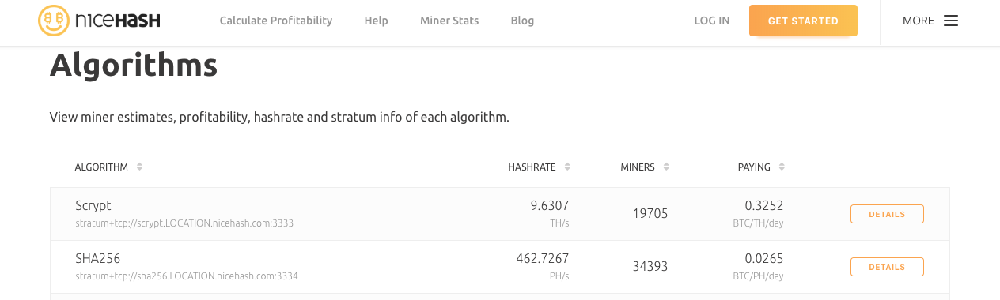
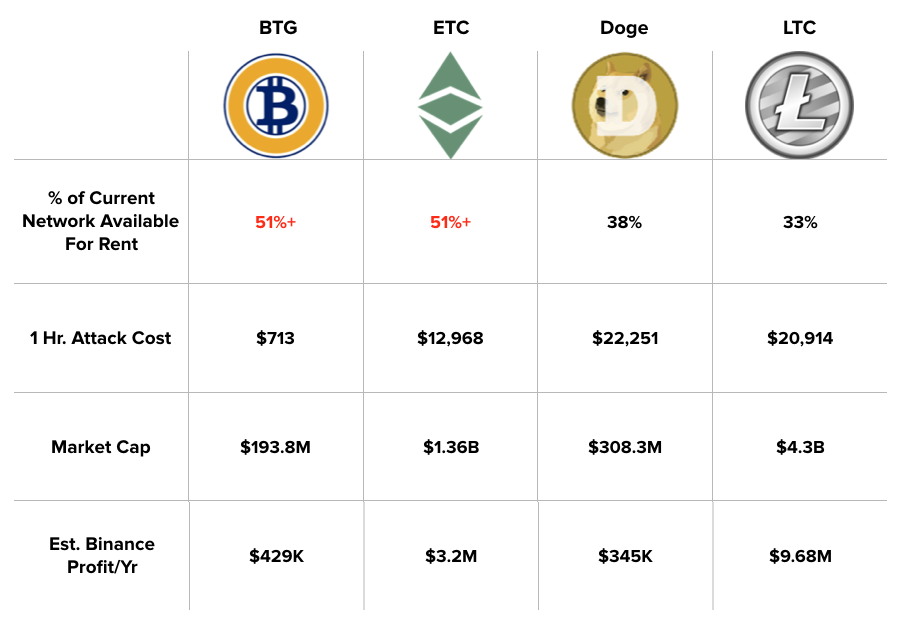
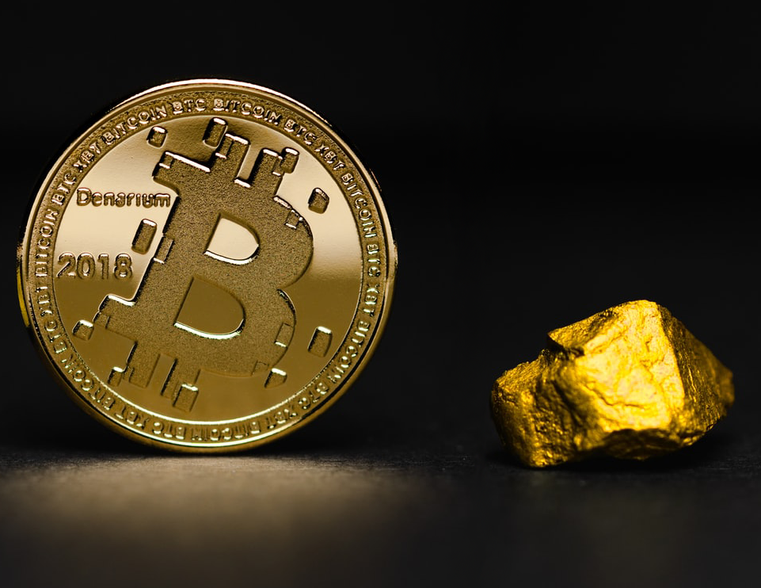

# Почему биржи не прекращают торги монетами после «атаки 51%»?

<strong>Оригинал: <a href="https://medium.com/dragonfly-research/why-dont-exchanges-delist-coins-after-51-attacks-dea404d33e3b">Ashwin Ramachandran &amp; Haseeb Qureshi (Dragonfly Research)</a></strong> 

23 января криптовалюта Bitcoin Gold подверглась “атаке 51%”, в результате чего 72 000 долларов были потрачены дважды. Последствия этой атаки, уже второй для Bitcoin Gold, заставили многих задаться вопросом: почему биржи не прекращают торги Bitcoin Gold и другими криптовалютами на базе proof-of-work, легко подверженными “атаке 51%”? 

Оказывается, этому существует простое объяснение. Но для начала давайте разберемся в обстоятельствах произошедшей атаки. 

Bitcoin Gold – это форк Биткоина с ASIC-устойчивым алгоритмом майнинга ZHash. Этот алгоритм оптимизирован для эффективного майнинга на GPU. Из-за высоких требований по памяти разрабатывать ASIC-майнеры для ZHash сложно. Аренда же графических процессоров (GPU) широко доступна, так как используются они далеко не только в майнинге. Поэтому несложно арендовать достаточное количество мощностей для доминирования в сети Bitcoin Gold. Рынки хэш-мощностей, такие как <a href="https://www.nicehash.com/">NiceHash</a> и <a href="https://www.miningrigrentals.com/">MiningRigRentals</a>, значительно снизили цену “атак 51%”. Более того, постоянно появляются новые аналогичные рынки (<a href="https://warihash.com/">Warihash</a>, <a href="https://mining.luxor.tech/en">Luxor</a> и т.д.).

<figure class="wp-block-image"></figure>

Для атаки на Bitcoin Gold понадобилось всего $3400 (около 0.4 BTC, предполагая линейное проскальзывание цены). Это позволило реорганизовать 29 блоков. Стоит заметить, что расходы атакующего окупились за счет вознаграждений за блоки в реорганизованной цепи. Стоимость атаки настолько невелика, что для нее <strong>достаточно рынков мгновенной аренды GPU. </strong>Более того, такие рынки становятся всё более ликвидными, что дополнительно снижает стоимость захвата блокчейнов с GPU-майнингом (см. <a href="https://www.crypto51.app/">цены</a> NiceHash). Таким образом, изначальный капитал злоумышленника состоит из того количества Bitcoin Gold, который он хочет потратить дважды, и денег на аренду хэш-мощности. В нашем случае ему было нужно $72 000 для двойной траты плюс $3400 на аренду GPU (вдобавок, около $4200 он получил за найденные блоки). В итоге возврат инвестиций такой атаки составил ~96,6% – крайне выгодное мероприятие.  

Конечно, главные жертвы “атак 51%” – биржи. Атаки обычно происходят так. Злоумышленник зачисляет монеты на биржу, меняет их на другие ликвидные монеты (например, BTC) и выводит BTC с биржи. Затем он отменяет первую транзакцию с помощью “атаки 51%”, получая обратно свой депозит и фактически тратя деньги дважды. Чтобы препятствовать такой атаке, биржи устанавливают минимальное количество подтверждений, необходимое для вывода монет (например, 12 блоков для Bitcoin Gold на Binance). Такие меры повышают безопасность, но не предотвращают атаки полностью. Если вы хотите узнать больше о механизме “атаки 51%”, предлагаем обратить внимание на прошлогодний <a href="https://twitter.com/hosseeb">Твиттер-тред @hosseeb</a>, в котором подробно разбиралась атака на Ethereum Classic (ETC).  Описанная выше атака на Bitcoin Gold была второй всего за два года (причем <a href="https://www.ccn.com/bitcoin-gold-hit-by-double-spend-attack-exchanges-lose-millions/">первая была значительно более крупной</a>), но большинство бирж, включая Binance, поддерживают BTG и по сей день. Естественно, возникает вопрос: почему Binance не отказывается от торгов BTG? 

Объем торгов в паре BTG / BTC на Binance составляет примерно $4,13 млн в неделю. Таким образом, годовая выручка только лишь от этой торговой пары оказывается в районе $429 000 (предполагая среднюю комиссию 0,2% и низкую популярность токена BNB).  После расчета выручки для всех PoW-монет с низкой и средней капитализацией ситуация проясняется. Для Binance более выгодно продолжать поддерживать такие монеты даже с учетом потенциальных потерь из-за “атак 51%”. В таблице ниже представлена оценка доступной для аренды хэш-мощности (в процентах от мощности сети) вместе с оценкой выручки биржи Binance (при текущих курсах) для нескольких криптовалют. 

<figure class="aligncenter is-resized"><figcaption> <strong>Уязвимые PoW-монеты (основано на текущих курсах; источники: Binance API, NiceHash, MiningRigRentals.com)</strong></figcaption></figure>

Заметим, что арендованная майнинговая мощность увеличивает хэшрейт сети. Поэтому злоумышленнику для “атаки 51%” требуется &gt;=100% текущего хэшрейта. Стоимость владения майнинговыми мощностями также подвержена линейному проскальзыванию рыночной цены, что может значительно увеличить затраты на атаку.

 Мы можем обобщить алгоритм принятия решения о том, нужно ли поддерживать торги потенциально уязвимой монетой, с помощью следующей формулы: 

<figure class="wp-block-image"></figure>

Выручка должна быть больше ожидаемых потерь от атак 

Пока формула верна, мы ожидаем, что Binance и другие популярные биржи продолжат поддерживать уязвимые PoW-монеты. Биржи всегда могут снизить вероятность “атаки 51%”, увеличив количество блоков, необходимых для вывода средств (например, после атаки Binance увеличили количество необходимых подтверждений для BTG с 12 до 20). Разумеется, это не устраняет атаку, а лишь увеличивает капитал, необходимый злоумышленнику. Биржи также могут защититься, отслеживая аномалии, связанные с депозитами PoW-монет с низкой капитализацией. Но способа обнаружить “атаку 51%” до ее осуществления не существует, так как сама по себе аренда майнинговой мощности не снижает хэшрейт сети. 

<figure class="aligncenter is-resized"></figure>

Последняя атака на Bitcoin Gold обошлась Binance примерно в $72 000, тогда как ожидаемая выручка от торговли BTG за текущий год составляет $429 000. Аналогично, “атака 51%” на Ethereum Classic принесла злоумышленнику около $1,1 млн, но Binance заработает на торговых комиссиях около $3,2 млн за год. В этом еще одна причина, по которой монеты не умирают после “атаки 51%”. 

Но всё же в “атаках 51%” есть загадки. Такие атаки выглядят как фундаментальное нарушение модели безопасности в PoW-монетах, но атакованные криптовалюты продолжают торговаться на ведущих биржах, и, что особенно удивительно, часто даже растут в цене (см. ETC, BTG, XVG). Частичное объяснение можно получить, рассмотрев “атаку 51%” как “налог на биржи” и моделируя их мотивацию продолжать поддерживать уязвимые монеты. Что же касается причин роста курса некоторых монет после атак… К сожалению, это остается загадкой.  Спасибо <a href="https://medium.com/@tomhschmidt">Тому Шмидту</a> и <a href="https://medium.com/@ivanbogatyy">Ивану Богатому</a> за рецензирование черновиков этого поста. Чтобы не пропустить другие статьи, подпишитесь на нас в Twitter: <a href="https://twitter.com/ashwinrz">@ashwinrz</a> и <a href="https://twitter.com/hosseeb">@hosseeb</a>. 

 

