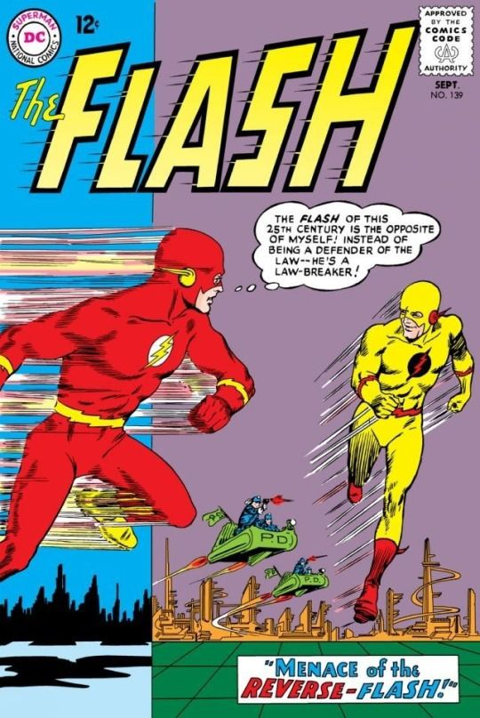
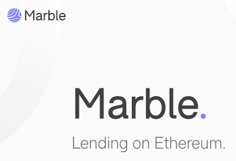
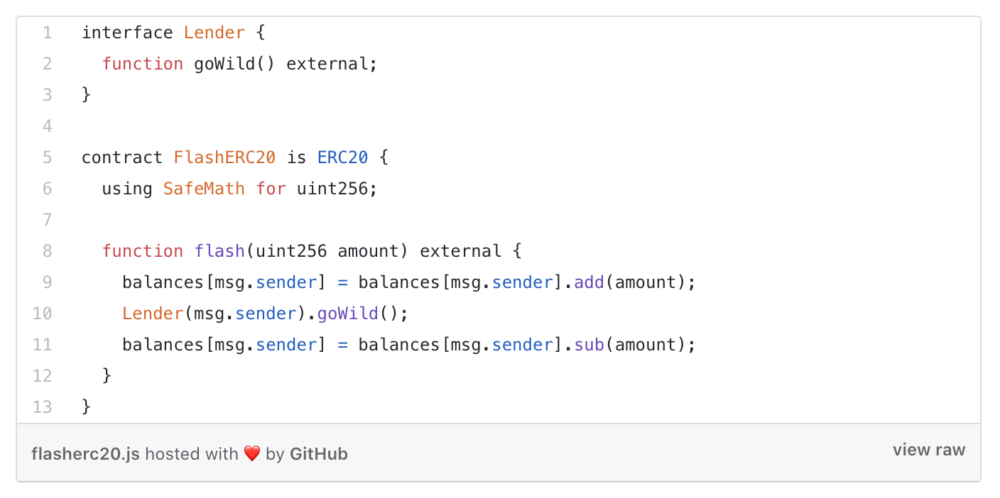
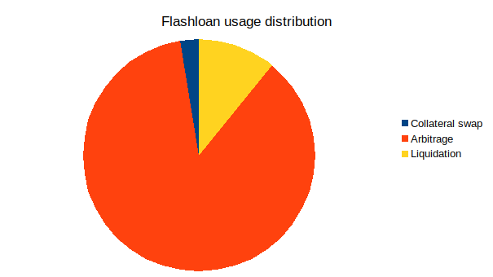

# Почему атаки с помощью мгновенных кредитов станут нормой

<strong>Эта статья сделана в партнерстве с DragonFly Research и является переводом материала </strong><a href="https://medium.com/dragonfly-research/flash-loans-why-flash-attacks-will-be-the-new-normal-5144e23ac75a"><strong>Flash Loans: Why Flash Attacks will be the New Normal</strong></a><strong> за авторством </strong><a href="https://twitter.com/hosseeb"><strong>Haseeb Qureshi.</strong></a>

Мгновенные кредиты (flash loans) в последнее время в центре внимания. Недавно с их помощью хакеры атаковали протокол маржинальной торговли bZx. <a href="https://www.palkeo.com/en/projets/ethereum/bzx.html">В результате двух похожих атак они похитили сначала 350 тысяч, а затем более 600 тысяч долларов.</a>

Эти атаки поражают воображение. В каждой из них злоумышленник, не имея ни цента, мгновенно занял эфиров на сотни тысяч долларов, пропустил их через ряд уязвимых ончейн-протоколов, присвоил активов на сотни тысяч долларов и сразу же вернул свои огромные кредиты. Всё это произошло мгновенно – в одной эфириум-транзакции.

<figure class="wp-block-image"><figcaption>Cover art by Carmine Infantino </figcaption></figure>

Мы не знаем, кто и откуда провел эти атаки. Злоумышленники практически без начального капитала скрылись с сотнями тысяч долларов. Следов, которые могли бы позволить их идентифицировать, они не оставили.

После этих атак я много думал о технологии мгновенных кредитов и её последствиях для безопасности DeFi и решил, что об этом вполне стоит порассуждать публично.

Вкратце: я считаю, что мгновенные кредиты никуда не денутся, хотя они представляют значительную угрозу. Поэтому мы должны тщательно учитывать их влияние на будущую безопасность DeFi.

<h2><strong>Что такое мгновенный кредит?</strong></h2>

Концепция мгновенных кредитов была впервые сформулирована в 2018 году Максом Волффом (Max Wolff), создателем <a href="https://medium.com/marbleorg/introducing-marble-a-smart-contract-bank-c9c438a12890">протокола Marble</a>. Marble, позиционировавший себя как “банк на смарт-контрактах”, предоставлял инновационный DeFi-продукт, гениальный в своей простоте – безрисковые кредиты на смарт-контрактах.

<figure class="wp-block-image"></figure>

Как кредит может быть безрисковым?

Традиционные кредиторы берут на себя две формы риска. Первый – <strong>риск неуплаты</strong> (дефолта). Паршиво, когда заемщик убегает с деньгами. Второй – <strong>риск неликвидности</strong>. Если кредитор выдает слишком много кредитов и не получает платежи по ним вовремя, он неожиданно оказывается неликвидным и не может выполнять уже свои собственные обязательства.

Мгновенные кредиты снижают оба риска. Они работают примерно так: я одолжу вам сколько угодно денег, но только для <em>одной конкретной</em> транзакции. К концу этой транзакции вы <em>должны</em> вернуть мне не меньше того, что я вам одолжил. Если вы не сможете этого сделать, транзакция будет автоматически отменена! (Да, смарт-контракты <a href="https://eips.ethereum.org/EIPS/eip-140">так умеют</a>.)  Проще говоря, ваш кредит является атомарным: если вы не можете его погасить, всё возвращается назад, словно никакого кредита и не было.

Подобное может существовать только на блокчейне. Скажем, на BitMEX мгновенные кредиты реализовать не получится. Дело в том, что платформы смарт-контрактов обрабатывают транзакции одну за одной. Каждая транзакция выполняется независимо от других, как при пакетной обработке запросов. На время выполнения транзакции время как бы останавливается. На централизованной площадке заявка может выполниться частично, а в блокчейне весь код гарантированно исполняется целиком, строчка за строчкой.  Подумаем теперь об экономике. Традиционные кредиторы получают награду за <strong>риски</strong> (дефолта и неликвидности) и за <strong>упущенную выгоду</strong> использования капитала. Например, если где-то я могу получать безрисковые 2% доходности на свой капитал, заемщик должен платить мне больше, чем 2%.

Мгновенные кредиты не похожи на обычные. У них нет риска дефолта и нет издержек упущенной выгоды! Ведь заемщик «заморозил время» на срок действия кредита. Поэтому, с точки зрения стороннего наблюдателя, капитал никогда не подвергался риску и не мог зарабатывать проценты где-либо ещё (то есть не имел альтернативной стоимости).

В каком-то смысле это означает, «мгновенные кредиторы» не несут издержек. Такой вывод противоречит базовой интуиции. Сколько же должен стоить мгновенный кредит на устоявшемся рынке?

По сути, <strong>мгновенные кредиты должны быть бесплатными</strong>. Точнее, достаточно амортизировать стоимость добавления в смарт-контракт трех строк кода, которые сделают актив доступным в виде мгновенного кредита. 

<figure class="wp-block-image"><figcaption>h/t&nbsp;<a rel="noreferrer noopener" href="https://twitter.com/recmo/status/1229171153597386752" target="_blank">Remco Bloemen</a></figcaption></figure>

За мгновенные кредиты невозможно взимать традиционные <em>проценты</em>, потому что время действия кредита равно нулю (любая процентная ставка, умноженная на ноль, дает ноль). Поэтому пулы, предлагающие кредиты по ставкам заметно выше нуля, будут быстро вытеснены конкурентами с более низкими ставками.

<strong>Мгновенное кредитование делает капитал поистине общедоступным.</strong> <a href="https://ru.wikipedia.org/wiki/%D0%93%D0%BE%D0%BD%D0%BA%D0%B0_%D0%BF%D0%BE_%D0%BD%D0%B8%D1%81%D1%85%D0%BE%D0%B4%D1%8F%D1%89%D0%B5%D0%B9">Гонка уступок</a> неизбежно приводит к нулевым или чисто символическим комиссиям. Сейчас dYdX выдает мгновенные кредиты бесплатно, тогда как AAVE просит 0,09%. Я предполагаю, что ситуация пока не устоялась: участники их сообщества <a href="https://medium.com/aave/flash-loans-one-month-in-73bde954a239">призывали снизить ставку до нуля.</a> (Заметим, что рассмотренные выше атаки не использовали AAVE в качестве пула мгновенного кредитования.)

<h2><strong>Для чего полезны flash loans?</strong></h2>

Изначально мгновенные кредиты продвигались как инструмент для арбитража. В анонсе <a href="https://medium.com/marbleorg/introducing-marble-a-smart-contract-bank-c9c438a12890">Marble говорилось</a>:

<blockquote class="wp-block-quote">
«С помощью мгновенного кредитования трейдер может взять кредит у банка Marble, купить токен на одной децентрализованной бирже, продать его дороже на другой децентрализованной бирже, погасить кредит и получить арбитражную прибыль – и всё это в одной атомарной транзакции.»
</blockquote>

И это правда: пока что большая часть мгновенных кредитов (по объёму), используется для подобного арбитража.

<figure class="wp-block-image"><figcaption>Flash loan usage on AAVE. Credit: AAVE</figcaption></figure>

Объемы, впрочем, крошечные. За всё время AAVE выдал мгновенных кредитов на десять с небольшим тысяч долларов. Это пренебрежимо мало по сравнению с рынком арбитража и ликвидации в DeFi.

Дело в том, что большинство арбитражей выполняются сложными ботами под управлением конкурирующих арбитражеров. Они участвуют в аукционах на <a href="https://twitter.com/phildaian/status/1116155253890613249">приоритетные поставки газа</a> и используют <a href="https://gastoken.io/">токены газа</a> (<a href="../../e024/index.html">ББ-024</a>) для оптимизации оплаты транзакций. Участники этого крайне конкурентного рынка не против держать на балансе некоторое количество токенов для повышения прибыли.

Кредит на AAVE, с другой стороны, стоит около <a href="https://developers.aave.com/#gas-consumption">80 тысяч газа</a> и 0,09% от суммы – значительная сумма для арбитражера, конкурирующего за крошечную маржу. Действительно, в большинстве арбитражей с <a href="https://medium.com/aave/flash-loans-one-month-in-73bde954a239">использованием AAVE</a> заемщик в конечном итоге платит больше за пользование кредитом, чем зарабатывает.

Скорее всего, в долгосрочной перспективе арбитражеры будут использовать мгновенные кредиты только в исключительных обстоятельствах.

Но у этой технологии есть и другие, даже более убедительные сценарии использования в DeFi, такие как рефинансирование кредитов. Скажем, у меня есть хранилище (vault), или CDP, в Maker на $100 в эфирах, и я занял у Maker 40 DAI. Таким образом, моя позиция – $60 минус долг. Теперь, допустим, я хочу рефинансировать свой долг в Compound, где процентная ставка лучше. В обычной ситуации мне нужно было бы выкупить эти 40 DAI, чтобы закрыть CDP, а это требует некоторого капитала. Вместо этого я могу взять мгновенный кредит на 40 DAI, закрыть CDP на $100, внести разблокированных эфиров на $60 в Compound, преобразовать оставшиеся $40 в эфирах обратно в DAI через Uniswap и погасить кредит. В итоге – атомарное рефинансирование с нулевым капиталом!

Настоящая магия! Отличный пример денежного lego™ в действии. <a href="https://1x.ag/#/">1x.ag </a>уже построил агрегатор маржинальной торговли, который автоматизирует подобные вещи, используя мгновенные кредиты. Но при всех притягательности этой технологии, злоумышленники, атаковавшие bZx, показали, что flash loans это не шутки.

<h2><strong>Серьезные последствия Flash-атак для безопасности</strong></h2>

Чем дальше, тем больше я прихожу к пониманию, что главное последствие мгновенных кредитов –&nbsp;капиталоемкие атаки с их использованием (flash-атаки). Недавние атаки на bZx – это только верхушка айсберга.

Мгновенные кредиты особенно привлекательны для злоумышленников по двум причинам.

<ol><li>Многие атаки (например, манипуляции оракулами) требуют большого начального капитала. Если вы зарабатываете положительный ROI на 10 млн долларов в эфире – скорее всего, дело тут нечисто. Это не простой арбитраж.</li><li>Flash loans позволяют злоумышленнику получить “чистые” деньги. Даже придумав, как проманипулировать оракулом с использованием эфира на 10 миллионов долларов, я, вероятно, не захочу рисковать собственным капиталом. Мои эфиры будет помечен как “грязные”, биржи отклонят мои зачисления, и деньги будет трудно отмыть. Это рискованно! Но если я возьму мгновенный кредит на 10 миллионов долларов, то кого это будет волновать? Никаких рисков, только прибыль. Весь залоговый пул dYdX не будет считаться грязным только потому, что я взял из него кредит. Отметка “грязные деньги” на dYdX просто испарится.</li></ol>

Возможно, вам не по душе, что блэклисты бирж являются частью современной модели безопасности в блокчейне. Блэклисты это централизованная и довольно спорная штука. Но расчёты, стоящие за обсуждаемыми атаками, учитывают этот важный аспект реальности.

Как известно, в <a href="https://bitcoin.org/bitcoin.pdf">вайтпейпере Биткойна</a> Сатоши обосновал безопасность биткоина тем, что:

<blockquote class="wp-block-quote">
“[Злоумышленник] должен обнаружить, что ему выгодней играть по правилам […], чем подрывать всю систему и свой собственный капитал”.
</blockquote>

Используя мгновенные кредиты, злоумышленники больше ничем не рискуют. Расчет рисков существенно меняется.

Не забывайте, что flash loans можно комбинировать! Не превышая ограничений по газу, вы можете объединить все кредитные пулы в одной транзакции (свыше 50 млн долларов) и обрушить весь этот капитал на один уязвимый контракт. Этим 50-миллионным тараном можно бить по любой блокчейн-<a href="https://ru.wikipedia.org/wiki/%D0%9F%D0%B8%D0%BD%D1%8C%D1%8F%D1%82%D0%B0">пиньяте</a>, пока из неё не посыпятся деньги. Звучит жутко.

Разумеется, само по себе большое количество денег <em>не должно</em> позволять вам атаковать протоколы. Если безопасность DeFi-стека соответствует обещаниям, все это не должно быть проблемой. Что это за протокол, если он не защищен от богатого “кита”? Можно сказать, что не учитывать это – просто халатность.

И все же мы признаем, что атака 51% на сам эфириум стоит <a href="https://www.crypto51.app/">меньше 200 тысяч долларов в час</a> **. Это не так уж много! Если модель безопасности самого Эфириума в основном построена на недоступности капитала, почему мы так иронизируем над DeFi-приложениями, уязвимыми к атакам за 10 миллионов долларов?

(** Поясню, что я не верю в этим цифрам. Они не учитывают проскальзывание цены и исчерпание предложения. Кроме того, безопасность на уровне консенсуса отличается от безопасности на уровне приложений. Но суть, надеюсь, понятна.)

<h2><strong>Так как же можно противостоять flash-атакам?</strong></h2>

Представим, что я DeFi-протокол и я хочу избежать flash-атак. Возникает естественный вопрос: могу ли я понять, что пользователь вызывает меня, используя мгновенный кредит?

Короткий ответ: <strong>нет</strong>.

EVM не позволяет читать переменные других контрактов. Так что если вы хотите знать, что происходит в другом контракте, только он может вам об этом рассказать. Таким образом, чтобы понять, используется ли в транзакции контракт, выдающий мгновенные кредиты, придется спросить у него. Сегодня многие протоколы кредитования не отвечают на такие запросы (и в целом нельзя заставить контракт-кредитор это делать). Кроме того, даже если вы попытаетесь это проверить, любой подобный запрос может быть легко перенаправлен с использованием прокси-контракта или при помощи вложенного использования нескольких пулов мгновенных кредитов. Так что понять, использует ли вкладчик мгновенный кредит, невозможно.

Задумайтесь об этом на секундочку. Если кто-то стучится в ваш контракт с 10 миллионами долларов, невозможно определить, его ли это деньги.

Итак, какие есть реалистичные способы защититься от flash-атак? Можем рассмотреть несколько подходов.

<ul><li><strong>Убедить пулы, предоставляющие мгновенные кредиты, не предлагать эту услугу</strong></li></ul>

Шучу, это ж крипта!

Если серьезно, попытка заставить кредитные пулы прекратить предлагать мгновенное кредитование подобна попытке остановить шумовое загрязнение. Это классическая трагедия общих ресурсов. В интересах каждого протокола – предоставлять мгновенные кредиты, и есть правомерные причины, по которым пользователи хотят эту функциональность. Так что смело отбросим эту идею. Мгновенные кредиты никуда не денутся.

<ul><li><strong>Разбивать критические транзакции на два блока</strong></li></ul>

Вспомним, что мгновенные кредиты позволяют заимствовать капитал на время <em>одной транзакции</em>. Если капиталоемкая транзакция занимает два блока, то пользователь должен взять кредит как минимум на два блока. Это предотвращает любые flash-атаки. (Примечание: чтобы эта схема работала, между двумя блоками капитал пользователя должен быть заморожен. Это не позволит ему погасить кредит. Если вы не продумаете дизайн правильно, пользователь сможет провести flash-атаку в <em>обоих</em> блоках.)

Очевидно, такое решение значительно ухудшает UX. Транзакции больше не будут синхронными. Пользователям нелегко будет смириться с таким неудобством.

Многие разработчики жалуются на асинхронные операции со смарт-контрактами, например, при взаимодействии с протоколами второго уровня или между шардами в Ethereum 2.0. По иронии судьбы, асинхронность фактически делает эти системы защищенными от flash-атак, поскольку в атомарной транзакции нельзя перемещаться между шардами или между уровнями. Так что никакие flash-атаки между шардами ETH 2.0 или на DEX на втором уровне невозможны.

<ul><li>Требовать ончейн-доказательство того, что баланс пользователя не увеличен с помощью мгновенного кредита</li></ul>

Мы могли бы победить flash-атаки, если бы был какой-то способ определить, каким был <em>реальный</em> баланс пользователя – то есть до того, как он взял кредит.

В EVM нет способа сделать это нативно, но можно применить трюк: перед тем, как пользователь провзаимодействует с вашим протоколом, вы запрашиваете Мёркл-пруф того, что в конце предыдущего блока у него был достаточный баланс, для используемого в настоящее время капитала. Вы должны отслеживать это для каждого пользователя в каждом блоке (благодарю Ари Джулса за объяснение этого подхода).

<em>Как-то</em> это работает. Но, конечно, здесь есть серьезные проблемы: проверка ончейн-доказательств <a href="https://github.com/lorenzb/proveth">невероятно дорогая</a>, и ни один пользователь в здравом уме не хочет их генерировать и платить за всё это газом. Кроме того, пользователи могли изменить свой баланс <em>ранее в том же блоке </em>по вполне законным причинам. Так что хоть такой способ и возможен теоретически, на практике он не применим.

Ни одно из этих трех предложенных мной решений не является особенно многообещающим. Я убежден, что хорошей универсальной защиты от flash-атак нет.

Впрочем, для двух типов приложений есть специфичные средства защиты от flash-атак. Речь об оракулах рыночных цен и о governance-токенах.

Для оракулов, таких как Uniswap или OasisDEX, возможность flash-атак означает, что вы <em>ни при каких обстоятельствах</em> не можете использовать текущую среднюю рыночную цену. Злоумышленнику не составит труда одной транзакцией спровоцировать краткосрочный провал цены (flash crash) и исказить цену в оракуле.

Лучшее решение здесь – использовать среднее значение на последних X блоков, взвешенное либо по времени (<a href="https://en.wikipedia.org/wiki/Time-weighted_average_price">TWAP</a>), либо по цене (<a href="https://en.wikipedia.org/wiki/Volume-weighted_average_price">VWAP</a>). В Uniswap v2 это будет реализовано по умолчанию. Существует также <a href="https://medium.com/marbleorg/introducing-polaris-ced195dd798e">Polaris</a> – обобщенный подход по расчету скользящих средних для протоколов DeFi. По иронии судьбы, Polaris был также построен Максом Волффом, первоначальным создателем Marble. (Проект Polaris теперь заброшен, но респект Максу за прозорливость.)

Ончейн-governance – это отдельный клубок проблем. Суть процесса заключается в принятии решений на основе взвешенного голосования среди держателей governance-токенов. Но если эти токены находятся в пуле мгновенного кредитования, то любой злоумышленник может собрать огромный капитал токенов и добиться любого исхода.

Конечно, большинство governance-протоколов требуют, чтобы эти токены были заблокированы на период голосования, что делает flash-атаки невозможными. Но некоторые формы голосования не требуют блокировки, например, <a href="http://carbonvote.com/">CarbonVote</a> или <a href="https://medium.com/coinmonks/how-to-turn-20m-into-340m-in-15-seconds-48d161a42311">исполнительный контракт Maker</a>. Теперь, когда мы имеем дело с flash-атаками, такие формы голосования можно считать абсолютно небезопасными.

В идеале было бы здорово, если бы кредитов в governance-токенах не существовала. Но это решает не эмитент, а рынок. <strong>Таким образом, все голосования по управлению должны требовать блокировок токенов для предотвращения flash-атак. </strong>Новый токен COMP проекта Compound идет на шаг дальше. В протоколе <a href="https://medium.com/compound-finance/compound-governance-5531f524cf68">все голоса взвешиваются по времени</a>, что усложняет даже обычные атаки с применением кредита на этот governance-токен.

Обобщая, <strong>все governance-токены должны иметь временные блокировки</strong>. При временной блокировке необходимо, чтобы все управленческие решения вступали в действие после определенной задержки (для Compound она составляет 2 дня). Это позволяет системе восстанавливаться после любых непредвиденных governance-атак. Хотя токен MKR пока не доступен в больших кредитах, было обнаружено, что MakerDAO <a href="https://twitter.com/ameensol/status/1229848488621428736">уязвим к такого рода атакам</a>. Этот вектор атаки был закрыт добавлением <a href="https://vote.makerdao.com/executive-proposal/activate-the-dai-debt-ceiling-adjustment-set-dai-savings-rate-spread-set-sai-stability-fee-lower-surplus-auction-bid-set-governance-delay-module">24-часовой задержки</a>.

<h2><strong>Что это означает в долгосрочной перспективе?</strong></h2>

Я считаю, что атаки на bZx изменили ситуацию.

Эти flash-атаки не станут последними. Вторая атака bZx была похожа на первую, и я подозреваю, что она вызовет волну атак в ближайшие месяцы. Теперь тысячи умных подростков из самых отдаленных уголков мира пробуют взломать все эти DeFi протоколы, исследуя их под микроскопом, пытаясь выяснить, есть ли какой-нибудь способ, которым они могут осуществить flash-атаку. Если им удастся воспользоваться уязвимостью, они также смогут заработать несколько сотен тысяч долларов – сумма, которая изменит жизнь человека в большинстве частей света.

Некоторые утверждают, что flash-атаки ничего не меняют, потому что они всегда были доступны для обеспеченного злоумышленника. Это и верно, и нет. Большинство китов не знают, как взломать смарт-контракты, а у большинства способных хакеров нет миллионов долларов. Теперь любой желающий может за копейки арендовать таран в 50 миллионов долларов. Теперь по-другому нужно подходить к строительству любого здания.

После взлома bZx быть взломанным с помощью flash-атаки будет так же постыдно, как быть вновь взломанным после атаки на DAO: сочувствовать вам не будут, вы должны были быть в курсе.

Наконец, эти случаи заставили меня задуматься о старой концепции крипты: <a href="https://arxiv.org/pdf/1904.05234.pdf">ценности, получаемой при майнинге</a>. Ценность, получаемая при майнинге – это общая ценность, которую майнеры могут извлечь из блокчейн-системы. Она включает в себя вознаграждение за блок и комиссию, но также включает в себя результат более злонамеренных действий, таких как изменение порядка транзакций или добавление мошеннических транзакций в блок.

В конечном итоге, вы должны думать о flash-атаках как об отдельных транзакциях в мемпуле, которые приносят кучу денег. Например, вторая атака на bZx принесла ETH прибыль в размере 645 тысяч долларов за одну транзакцию. Допустим, вы майнер и собираетесь начать майнинг нового блока. Вы смотрите на транзакции предыдущего блока и думаете: «Погодите! Почему я пытаюсь добыть новый блок за ~ 500 долларов, если в последнем блоке содержится 645 тысяч долларов прибыли?»

Вместо того, чтобы продолжать цепочку, вам будет выгоднее вернуться назад и попытаться переписать историю так, чтобы вы были злоумышленником, использующим flash-атаку. Задумайтесь: одна только эта транзакция принесла бы больше, чем четыре часа честной добычи эфириум-блоков!

Это равносильно наличию особого суперблока, который содержит 1000-кратную награду по сравнению с обычным блоком. С рациональной точки зрения логично, что результатом существования такого суперблока будут попытки майнеров отбросить конец цепочки и украсть суперблок.

<figure class="wp-block-image"><figcaption>Соревнование майнеров: взгляд художника. Credit: AP Photo/Denis Poroy</figcaption></figure>

В равновесном состоянии все flash-атаки в конечном итоге должны быть добыты майнерами. (Обратите внимание, что они также должны в конечном итоге похитить весь он-чейн-арбитраж и ликвидации.) Забавно, что это послужит сдерживающим фактором против flash-атак: злоумышленники не смогут монетизировать найденные уязвимости. Возможно, в конце концов майнеры в частном порядке начнут платить потенциальным злоумышленникам за поиск атаки и предоставление необходимого кода для ее осуществления. Технически это может быть сделано без доверия, используя доказательства с нулевым разглашением. (Удивительно, правда?)

Но пока это всё научная фантастика. Очевидно, сейчас майнеры так не делают.

Почему?

Причин множество. Это тяжело, требует работы, для EVM трудно делать симуляции, это рискованно, будут ошибки, которые приведут к потере средств или появлению отброшенных блоков. Всё это может привести к лишнему шуму вокруг майнингового пула, потере доверия, а ещё их могут объявить «врагами эфириума». На данный момент майнеры больше бы потеряли (и в бизнесе, и в исследованиях и разработках, и в блоках), если бы попытались это сделать.

Это верно сегодня.

Но это не будет верно всегда.

Это дает еще один стимул для Ethereum поторопиться и перейти на Ethereum 2.0. DeFi на Ethereum это весело, но полностью и бесповоротно сломано. DeFi в блокчейн-системе с PoW ненадежен, потому что все ценные транзакции являются мишенью для майнеров (эта проблема также известна как <a href="https://arxiv.org/abs/1904.05234">атака временных бандитов</a>).

Для масштабирования таких систем вам нужна финальность – неспособность майнеров переписать подтвержденные блоки. Это предотвратит пересмотр транзакций в предыдущих блоках. Кроме того, если протоколы DeFi существуют на отдельных шардах Ethereum 2.0, они не будут уязвимы для flash-атак.

Я считаю, что flash-атаки в очередной раз напоминают, что мы только делаем первые шаги. Мы все еще далеки от устойчивой архитектуры для построения финансовой системы будущего. Об этом полезно помнить.

А пока flash loans станут новой нормой. Возможно, в долгосрочной перспективе любые активы в Ethereum можно будет одолжить как мгновенные кредиты. Все депозиты на биржах, все залоги в Uniswap, возможно, даже любые ERC-20 токенов.

Почему нет? Для это нужно всего лишь несколько строк кода. 

