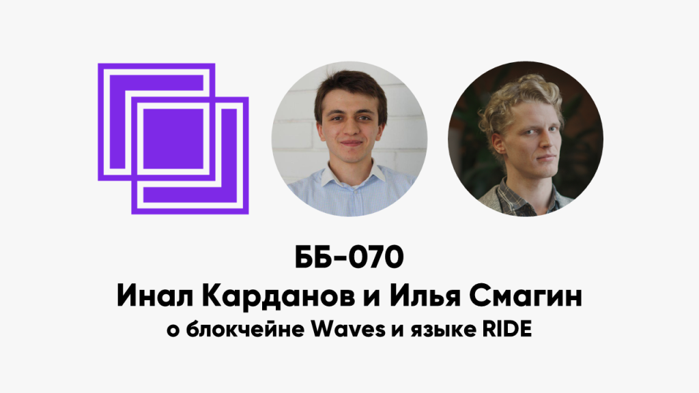

ББ-070: Инал Карданов и Илья Смагин о блокчейне Waves

<figure class="wp-block-image"></figure>

Тема выпуска &#8212; блокчейн-платформа Waves.

<ul> 
<li>0:25 как гости попали к блокчейн-индустрию?</li>
<li>1:20 чем занимается developer advocate?</li>
<li>3:30 что такое Waves? что уже реализовано?</li>
<li>5:15 кто аудитория проекта? Waves как вторая платформа для токенизации</li>
<li>6:30 почему кто-то решил выпустить токен на Waves, а не на Ethereum?</li>
<li>8:23 примеры и механика токенизации</li>
<li>9:35 чем Waves отличается от Ethereum? О введении сущностей первого уровня и сколько их в Waves</li>
<li>12:45 типы транзакций в Waves</li>
<li>13:15 как устроен консенсус Waves-NG? Чем отличается от Bitcoin-NG?</li>
<li>14:15 Leased proof-of-stake (fair PoS) и источник рандома</li>
<li>18:10 проблема PoS-ключей в горячих кошельках</li>
<li>19:19 о микроблоках и форках в NG-протоколах</li>
<li>22:20 сколько блоков нужно для finality?</li>
<li>24:20 как устроена награда за блок?</li>
<li>26:48 Bitcoin-NG разрабатывался для PoW, применим ли он для PoS?</li>
<li>27:30 как решается проблема nothing at stake?</li>
<li>30:46 грозит ли Waves чрезмерная концентрация токенов?</li>
<li>33:20 эмиссия в Waves</li>
<li>33:50 как устроена экономика лизинга токенов?</li>
<li>37:19 что такое smart assets и smart accounts?</li>
<li>42:30 в Waves нет газа?</li>
<li>45:35 сколько майнеров, где они?</li>
<li>46:40 о смарт-контрактах и языке RIDE</li>
<li>49:30 какой язык вдохновил разработку RIDE?</li>
<li>51:55 куда компилируется RIDE и где исполняется?</li>
<li>52:57 почему просто не написать DSL на Scala?</li>
<li>53:57 чем RIDE похож на Bitcoin script?</li>
<li>55:50 Waves: non-Turing-complete and stateful</li>
<li>58:00 self-reproducing coins as universal Turing machine</li>
<li>59:00 какие новые возможности даёт RIDE</li>
<li>1:01:20 Waves wallet и централизованные gateways</li>
<li>1:04:30 осмысленно ли использовать Waves как обменник?</li>
<li>1:05:38 как работает Waves DEX?</li>
<li>1:12:20 сколько пользователей у DEX?</li>
<li>1:13:48 энтерпрайз-блокчейн Vostok</li>
<li>1:15:30 о Waves как компании</li>
<li>1:17:40 проекты-партнёры Waves: Binary district, Research institute</li>
<li>1:20:35 будущее публичных и приватных блокчейнов</li>
<li>1:23:00 инкубатор Waves и вакансии</li>
</ul>

Ссылки:

<ul> 
<li><a href="https://wavesplatform.com/">Waves platform</a></li>
<li><a href="https://www.youtube.com/watch?v=k7gK7FgUFiU">Live Q&amp;A session with Ilya Smagin, RIDE Development Team Lead (March 22nd 2019)</a></li>
<li><a href="https://medium.com/@ikardanov/how-to-run-waves-node-on-a-smartphone-eeb8817b8d56"> How to run Waves node on a smartphone</a></li>
<li><a href="https://docs.wavesplatform.com/en/">About Waves Platform</a></li>
<li><a href="https://arxiv.org/abs/1806.10116">Self-Reproducing Coins as Universal Turing Machine</a></li>
<li><a href="https://www.rbc.ru/newspaper/2018/12/20/5c1914ab9a794736ee82fed4">Vostok — дело на $120 млн</a></li>
<li><a href="https://vk.com/@wavesplatform-waves-zapuskaet-inkubator-dlya-razrabotchikov-prilozhenii-na"> Waves запускает инкубатор для разработчиков приложений на блокчейне</a></li>
<li><a href="https://testnet.ide.wavesplatform.com/">Waves IDE</a></li>
<li><a href="http://www.shadowera.com/">Shadow Era &#8212;&nbsp;The First Properly Tokenized Game On Waves</a></li>
</ul>

<a href="../index.html">basicblockradio.com</a>

