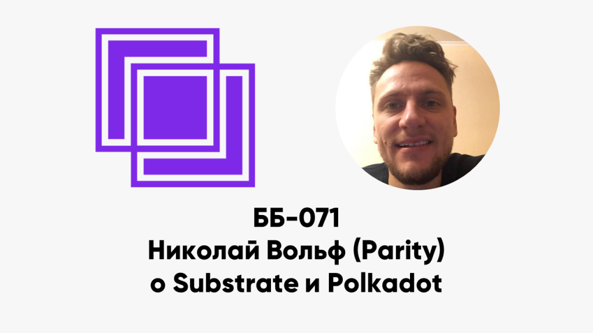

ББ-071: Николай Вольф (Parity) о Substrate и Polkadot

<figure class="wp-block-image"></figure>

<ul> 
<li>00:17 how you got into crypto, как узнал о блокчейне</li>
<li>02:35 как Николай пришёл в Parity?</li>
<li>03:20 биткойн и эфириум с точки зрения либертарианства</li>
<li>04:42 что такоe Substrate?</li>
<li>07:33 кто будет использовать Substrate?</li>
<li>10:33 на каких языках пишутся контракты?</li>
<li>11:05 что такое WebAssembly и чем хороша для блокчейнов?</li>
<li>14:39 как изменили generic WebAssembly для Substrate?</li>
<li>16:30 кто платит за вычисления, как устроен газ?</li>
<li>18:04 определение газа заранее эквиваленто задаче останова?</li>
<li>20:48 пользователи платят за газ криптовалютой?</li>
<li>22:33 обновления без форков</li>
<li>23:31 альтернативная имплементация на JavaScript</li>
<li>24:52 гибридный консенсус PBFT / Aurand</li>
<li>27:28 collective coin flipping</li>
<li>29:54 кросс-платформенная абстракция базы данных</li>
<li>33:20 применения для юз-кейсов кроме блокчейнов?</li>
<li>33:59 живые юз-кейсы</li>
<li>34:30 альтернативы Substrate</li>
<li>36:00 технологии в основе Substrate: современные или неопробованные?</li>
<li>37:05 (почти) биткойн-нода за 100 строк кода</li>
<li>39:10 что такое Polkadot?</li>
<li>40:29 что такое передавать ценность между блокчейнами?</li>
<li>41:33 обмен между биткойном и другим блокчейном: через каналы?</li>
<li>43:08 что такое pooled security?</li>
<li>44:41 может ли быть double spend?</li>
<li>47:23 Polkadot знает правила валидности подключённых блокчейнов?</li>
<li>48:06 пример: обмен Alice-coin на Bob-coin</li>
<li>52:30 загробная жизнь блокчейнов</li>
<li>53:23 экономическая мотивация валидаторов</li>
<li>56:23 The Polkadot: единая сеть с governance</li>
<li>58:12 как работает governance? голосование за бинарник</li>
<li>59:02 аналогия с Tezos и минусы голования за имплементацию</li>
<li>1:02:00 проблемы демократии для сложных систем</li>
<li>1:07:40 юз-кейс Polkadot</li>
<li>1:08:26 Polkadot &#8212; конкурент Ethereum?</li>
<li>1:09:15 почему выбрали язык Rust?</li>
<li>1:10:47 эволюция видения Web 3.0</li>
<li>1:11:55 Parity для энтерпрайза</li>
</ul>

Ссылки:

<ul> 
<li><a href="https://www.parity.io/">Parity</a></li>
<li><a href="https://www.parity.io/substrate/">Substrate</a></li>
<li><a href="https://polkadot.network/">Polkadot</a></li>
<li><a href="https://www.parity.io/a-brief-summary-of-everything-substrate-polkadot/"> A brief summary of everything Substrate and Polkadot</a></li>
<li><a href="https://www.parity.io/what-is-substrate/">What is Substrate?</a></li>
</ul>

<a href="../index.html">basicblockradio.com</a>

