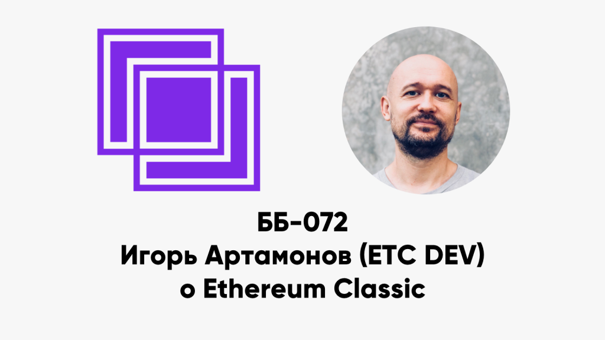

ББ-072: Игорь Артамонов (ETC DEV) о Ethereum Classic

<figure class="wp-block-image"></figure>

<ul>
 	<li style="list-style-type: none;">
<ul>
<li>00:21 как Игорь узнал про взлом The DAO?</li>
<li>05:04 можно ли вмешиваться в блокчейны на раннем этапе развития?</li>
<li>07:38 а баги в протоколе можно чинить хард-форками?</li>
<li>09:57 история зарождения Ethereum Classic</li>
<li>14:02 кто определял стратегию развития ETC?</li>
<li>16:10 первая большая DoS-атака на ETC (и ETH)</li>
<li>19:18 команды разработчиков ETC Dev и IOHK</li>
<li>20:30 почему IOHK забросили проект Mantis?</li>
<li>23:05 организация работы ETC Dev</li>
<li>24:03 в чём отличие задач ETC от ETH и блокчейн для роботов</li>
<li>28:15 монетарная политика ETC: сколько ETC с пресейла держит Ethereum Foundation?</li>
<li>32:28 на что ориентирован governance ETC</li>
<li>35:42 value proposition и технические особенности ETC</li>
<li>37:14 что такое сайдчейн?</li>
<li>40:45 сайдчейны и другие методы L2 для ETC</li>
<li>41:37 важно сохранить совместимость с ETH?</li>
<li>43:13 совместимость смарт-контрактов</li>
<li>45:12 виртуальная машина SputnikVM и лицензирование Ethereum</li>
<li>49:12 движение в сторону proof-of-stake?</li>
<li>52:18 история захвата Ethereum Classic</li>
<li>1:02:50 кошелёк Emerald</li>
<li>1:03:53 атака 51% на Ethereum Classic</li>
<li>1:08:42 причём тут Мавроди?</li>
<li>1:10:08 насколько сложную логику можно класть на блокчейн?</li>
</ul>
</li>
</ul>

Ссылки:

<ul>
 	<li style="list-style-type: none;">
<ul>
<li><a href="https://www.etcdevteam.com/">ETCDEV</a>&nbsp;(<a href="https://github.com/etcdevteam">Github</a>)</li>
<li><a href="https://ethereumclassic.org/">Ethereum Classic</a></li>
<li><a href="https://emeraldwallet.io/">Emerald Wallet</a></li>
<li><a href="https://www.youtube.com/watch?v=OWCUE9r2pdE">Let&#8217;s Talk ETC! #45 &#8212; Igor Artamonov (Splix) of ETCDEV</a></li>
<li><a href="https://www.youtube.com/watch?v=C3D_akWu-EI">Blockchain is for Robots by Igor Artamonov @ BlockChainConf.Tech</a></li>
<li><a href="https://www.youtube.com/watch?v=N6LqgG10_dI">ETCDEV&#8217;s Solution for Scaling ETC &#8212; 2018 ETC Summit</a></li>
</ul>
</li>
</ul>

<a href="../index.html">basicblockradio.com</a>

