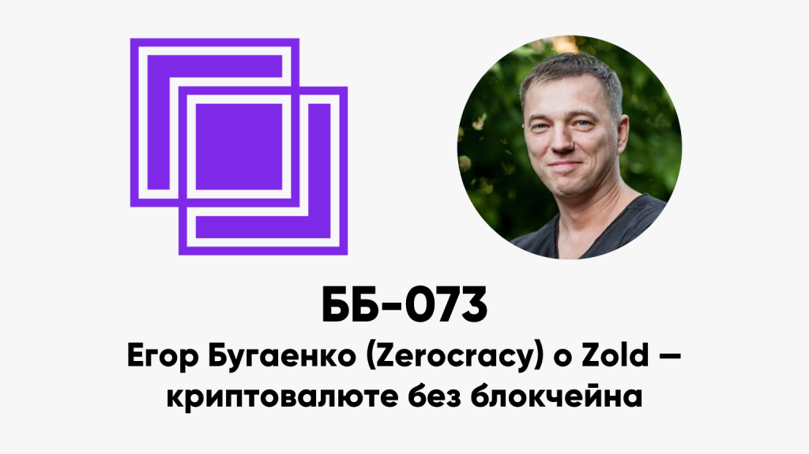

ББ-073: Егор Бугаенко (Zerocracy) о Zold — криптовалюте без блокчейна

<figure class="wp-block-image"></figure>

<ul> 
<li>00:25 как регулярно писать блог и записывать подкаст?</li>
<li>04:18 что такое Zerocracy?</li>
<li>06:42 если метод Zerocracy это эффективно, почему не видно конкурентов?</li>
<li>08:18 кто ставит программистам задачи?</li>
<li>09:58 что мешает заказчикам перейти на Zerocracy?</li>
<li>14:54 мог ли Сатоши придумать биткойн в системе тикетов?</li>
<li>18:25 применима ли Zerocracy для задач безопасности?</li>
<li>22:25 Zold: зачем ещё одна криптовалюта?</li>
<li>25:11 техническая составляющая важнее экономической?</li>
<li>28:12 proof-of-work: необходимость объективной проверки</li>
<li>30:45 в Zold нет глобального леджера?</li>
<li>34:17 как решается проблема двойной траты?</li>
<li>38:02 ограничение по времени для пересмотра транзакции</li>
<li>43:32 как выбирать соседей по сети?</li>
<li>46:08 хеш должен зависеть от транзакции? можно ли просчитать PoW заранее?</li>
<li>50:21 как регулируется сложность?</li>
<li>51:30 PoW на SHA256: опасность атаки от биткойн-майнеров</li>
<li>52:11 &#171;мастер-нода всегда права&#187;: надо ли их убрать?</li>
<li>57:00 можно было просто поставить базу данных?</li>
<li>58:50 разработчики контролируют биткойн?</li>
<li>1:15:27 откуда берутся золды: финансовая модель</li>
<li>1:19:15 мотивация узлов и налоги</li>
<li>1:22:33 роль Zold в Zerocracy</li>
<li>1:30:48 кто разрабатывает Zold?</li>
</ul>

Ссылки:

<ul> 
<li><a href="https://www.zerocracy.com/">Zerocracy</a></li>
<li><a href="https://www.zold.io/">Zold</a> (<a href="https://t.me/zold_io">Телеграм-чат</a>)</li>
<li><a href="https://www.yegor256.com/">Yegor&#8217;s Blog About Computers</a></li>
<li><a href="https://cacm.acm.org/blogs/blog-cacm/236106-blockchain-was-the-first-but-will-not-be-the-last/fulltext"> Blockchain Was the First, but Will Not Be the Last</a></li>
</ul>

<a href="../index.html">basicblockradio.com</a>

