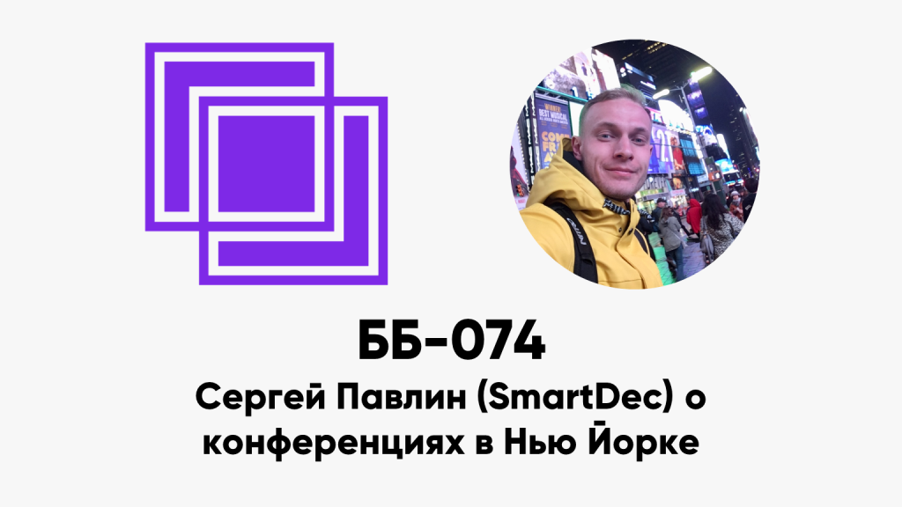

ББ-074: Сергей Павлин (SmartDec) о конференциях в Нью-Йорке

<figure class="wp-block-image"></figure>

Смотрите видео из Нью-Йорка на нашем YouTube-канале: <a href="https://www.youtube.com/watch?v=IkjSNyfNHdw">обзор</a>, <a href="https://www.youtube.com/watch?v=SEhAy7Pzpg8">интервью по-английски</a>, <a href="https://www.youtube.com/watch?v=Vu4QIqn8sjA">интервью по-русски</a>. Подписывайтесь, чтобы не пропустить новые репортажи!

<ul>
<li style="list-style-type: none;">
<ul>
<li>00:28 как погодка в Нью-Йорке?</li>
<li>01:06 сколько раз звучало слово BUIDL? а HODL?</li>
<li>02:05 токенизация и токенизация?</li>
<li>04:50 для кого были конференции? Fluidity, Ethereal, Consensus</li>
<li>07:05 Fluidity и DeFi. Kyber network, Uniswap и другие</li>
<li>18:43 Ethereal и форс инфантильности в Ethereum</li>
<li>22:50 почему банки не внедряют Ethereum?</li>
<li>26:32 куда бы вложили миллион: BTC vs ETH</li>
<li>32:30 панельная дискуссия: layer-1 vs layer-2</li>
<li>40:53 Consensus</li>
<li>45:25 куда двигается zero knowledge</li>
<li>48:17 доклад Blockstack</li>
<li>52:00 RSK и RIF</li>
<li>57:25 Blockstream Satellite: биткойн из космоса</li>
<li>1:02:02 исполнять на приватном, заверять на публичном блокчейне</li>
<li>1:03:30 система для хранения данных для NEO</li>
<li>1:05:25 блокчейн и healthcare</li>
<li>1:07:00 Tezos: onboarding department льёт воду и обновление &#171;Афины&#187;</li>
<li>1:08:55 Tezos это не DPOS!</li>
<li>1:13:50 зачем ездить на конференции?</li>
</ul>
</li>
</ul>

Ссылки:

<ul>
<li style="list-style-type: none;">
<ul>
<li><a href="https://www.fluiditysummit.com/">Fluidity Summit</a></li>
<li><a href="https://etherealsummit.com/events/ethereal-ny/">Ethereal Summit</a></li>
<li><a href="https://www.coindesk.com/events/consensus-2019">Consensus</a></li>
<li><a href="https://www.youtube.com/watch?v=CyieujRFk3g">Magical Crypto Conference</a></li>
</ul>
</li>
</ul>
