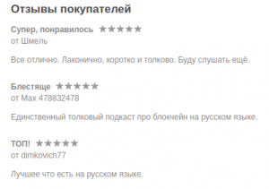

# О подкасте

«Базовый блок» — русскоязычный подкаст о блокчейн-технологиях.

Интересуетесь блокчейном, но устали от буллшита? Вам сюда. В «Базовом блоке» говорят о блокчейне по существу.

Как поменялся курс за неделю? Сколько миллионов собрало последнее ICO? Пофиг! В «Базовом блоке» — только технологии. Обсудим последние усовершенствования в Биткойне и Эфириуме, свежие академические статьи и индустриальные конференции. Криптографические алгоритмы, механизмы консенсуса, языки смарт-контрактов.

Давайте вместе разбираться, как устроен блокчейн!

Ведущие:

* [Сергей Тихомиров](https://s-tikhomirov.github.io/) — PhD student ([CryptoLUX](https://www.cryptolux.org/index.php/Home), [University of Luxembourg](https://wwwen.uni.lu/))
* [Иван Иваницкий](https://twitter.com/IvanitskiyIvan) — Product Manager ([Parsiq](https://www.parsiq.net/))
* [Сергей Павлин](https://twitter.com/srg_pavlin) — Product Manager ([Avito](https://avito.ru/))
* [Александр Селезнев](https://t.me/msbenighted) — CEO and Founder ([Pessimistic Security](https://pessimistic.io/))

Менеджер:

* [Кириллов Никита](https://t.me/youarebittersweet) — Project Manager ([Pessimistic Security](https://pessimistic.io/))

Официальные каналы ББ: [RSS](https://basicblockradio.libsyn.com/rss), [iTunes](https://itunes.apple.com/ru/podcast/id1289965366), [Яндекс.Музыка](https://music.yandex.ru/album/7638583), [YouTube](https://www.youtube.com/channel/UC95bSmaFa7R33GOyi6VfyGQ), [Google Podcasts](https://podcasts.google.com/?feed=aHR0cDovL2Jhc2ljYmxvY2tyYWRpby5saWJzeW4uY29tL3Jzcw), [Spotify](https://open.spotify.com/show/4flYcruRigqZVPYBZRtMHa), [Telegram](https://t.me/basicblockradio) (+ [чат](https://t.me/basicblockradio_chat)), [Twitter](https://twitter.com/basicblockradio), [VK](https://vk.com/basicblockradio).

[Поддержите подкаст](https://basicblockradio.com/donate/)!

